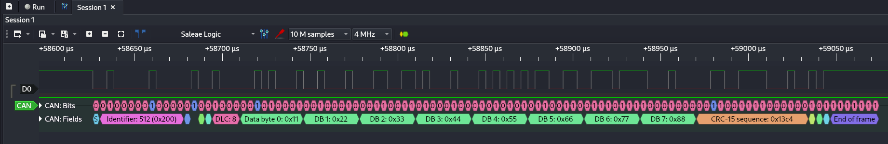
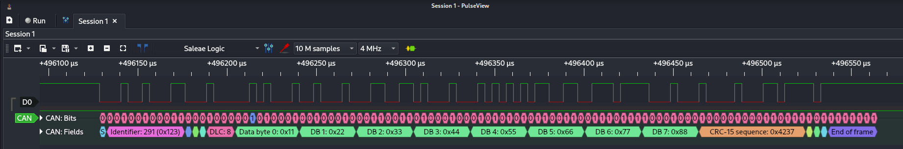
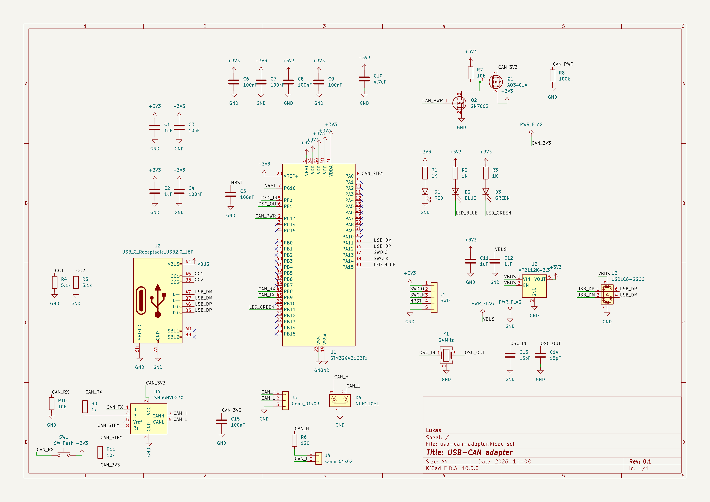

# stm32-can-system

I'm a second-year microelectronics student at Poznań University of Technology.
In this project I'm learning the CAN bus and designing my first SMD board.

The goal is a small CAN system with three parts:

1. A USB-CAN adapter: my own board with an STM32G431. A Linux laptop sees it as `can0`.
2. A J1939 node: a board with three power outputs, current measurement and its own buck converter.
3. A Python script on Linux that reads the node's status and switches its outputs through the adapter.

Right now I'm working on the adapter.

## What works

- NUCLEO-G431RB bring-up: LED, `printf` over UART, breakpoints in the debugger
  ([firmware/01-blinky](firmware/01-blinky))
- CAN in loopback mode at 250 kbit/s: the STM32 sends frame `0x123` with 8 data bytes
  and receives it back inside the chip ([firmware/02-can-loopback](firmware/02-can-loopback))
- Two CAN nodes on a real bus at 250 kbit/s: the Nucleo with an SN65HVD230 transceiver
  ([firmware/03-can-two-nodes](firmware/03-can-two-nodes)) and an Arduino Nano with an
  MCP2515 module ([firmware/nano-can](firmware/nano-can)). Each node sends one frame per
  second and the Nucleo prints the frames it gets from the Nano.

Both frames captured on the Nucleo's CAN RX pin (PB8) with a cheap 8-channel logic
analyzer at 4 MHz and decoded in PulseView. One bit takes 4 µs, which is 250 kbit/s.

Frame `0x200` from the Nano:

Frame `0x123` from the Nucleo:

## In progress

- The adapter schematic in KiCad ([hardware/usb-can-adapter](hardware/usb-can-adapter)).
  Done so far: the STM32 with decoupling, LEDs, SWD header, USB-C, the 3.3 V LDO, USB ESD
  protection and a 24 MHz crystal. The CAN transceiver is next. I use the open-source
  CANable 2.0 as a reference and want to order the PCB in early November.

## What I learned so far

- STM32CubeIDE 2.x no longer includes CubeMX. You set up the chip in CubeMX and import
  the project into the IDE.
- The CAN controller in the STM32G4 has only 3 slots in its transmit queue. Sending in
  a loop without a delay fills it right away.
- On this chip the CAN RX pin (PB8) is also BOOT0. A transceiver keeps RX high, so after
  a reset the chip may start its bootloader instead of my program. The fix is in the
  option bytes (nSWBOOT0 = 0, nBOOT0 = 1). My Nucleo already came set this way, and on
  the adapter I'll set them over SWD.
- A CAN bus needs a 120 Ω resistor at each end. Between CANH and CANL you should measure
  about 60 Ω with the power off. I measured 59 Ω. Before that I got 0 Ω because the
  jumper was on the wrong header and shorted the two lines.
- The PulseView CAN decoder starts at 1 Mbit/s. At the wrong bitrate it shows nonsense
  IDs. Measuring one bit time (4 µs) told me what to set.
- PulseView on my Windows 11 laptop could not open the logic analyzer
  (`LIBUSB_ERROR_NOT_SUPPORTED`, with both WinUSB and libusbK drivers). It works in a
  Linux VM in VirtualBox with USB passthrough.
- KiCad 10 keeps a local history folder with its own git repository inside. I added it
  to `.gitignore`.

## Next steps

- [x] Two nodes on a real bus, frames decoded in PulseView
- [ ] Adapter: finish the schematic and layout, order the PCB
- [ ] Adapter: solder it and get `can0` working on Linux
- [ ] J1939 node: buck converter design, 4-layer PCB, measurements
- [ ] Python script with `python-can` and `cantools`

## Building the firmware

Open a folder from `firmware/` in STM32CubeIDE (File → STM32 Project Create/Import),
build it and run it on a NUCLEO-G431RB. The serial output goes to the ST-LINK COM port
at 115200 8N1.

I write short notes after each session in [docs/lab-notebook.md](docs/lab-notebook.md)
(in Polish).
